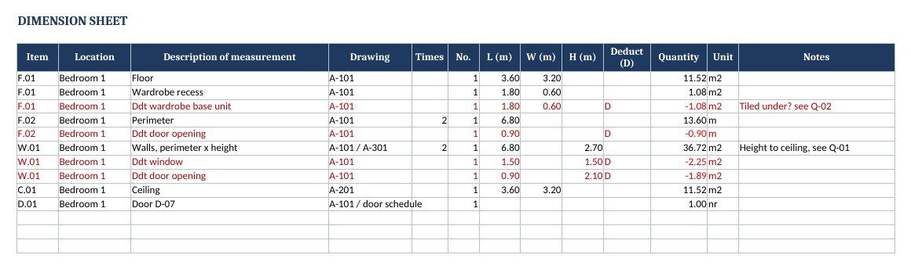
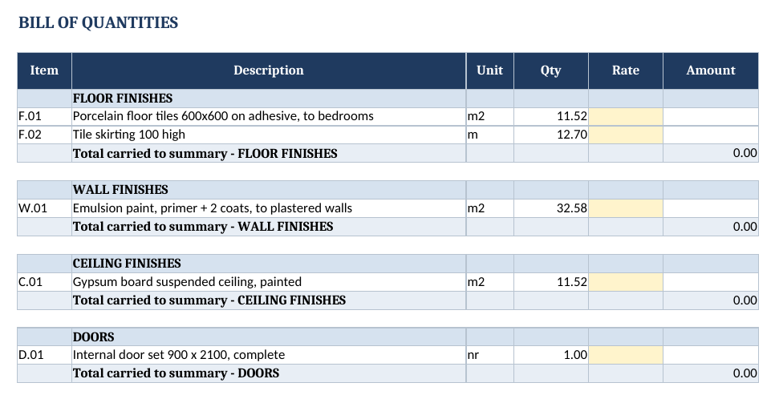

# BoQ measurement template (Excel)

The workbook structure I use for quantity takeoffs: every quantity in the bill traces back to a line of measurement with its drawing reference, so a client or estimator can check any number in seconds.

## Sheets
| Sheet | Purpose |
| --- | --- |
| **Cover** | Project, drawings and revision, measurement basis (NRM2, ASMM, POMI ...), how to use |
| **Dim Sheet** | One line per measurement: item code, location, description, drawing, Times × No. × L × W × H. Put **D** in *Deduct* and the line turns red and negative |
| **BoQ** | Items grouped by trade; quantity = SUMIF of the dimension sheet by item code; rate × qty = amount |
| **Summary** | Trade totals, contingency %, grand total |
| **Queries** | Every assumption made while measuring, with the drawing it relates to and its status |

## Why it is built this way
- **Traceable**: no typed-in quantities in the bill, only formulas pointing at measured lines.
- **Deductions are visible**: openings and omissions stay on the sheet in red instead of being netted off in your head.
- **Assumptions are written down**: missing heights, unclear scope and similar go to *Queries*, so they become RFIs and not surprises.
- **Rates are separate**: the same measured bill can be priced by different subcontractors.

The example inside is a single bedroom (floor tiling, skirting, paint, ceiling, door) to show the method. Replace the lines with your own project.

## Files
- `BoQ_Measurement_Template.xlsx`: the template, ready to use
- `build_template.py`: generates the workbook with Python and openpyxl (`pip install openpyxl`, then `python build_template.py`)

## License
MIT. Written with AI assistance.
